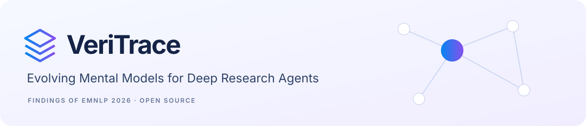
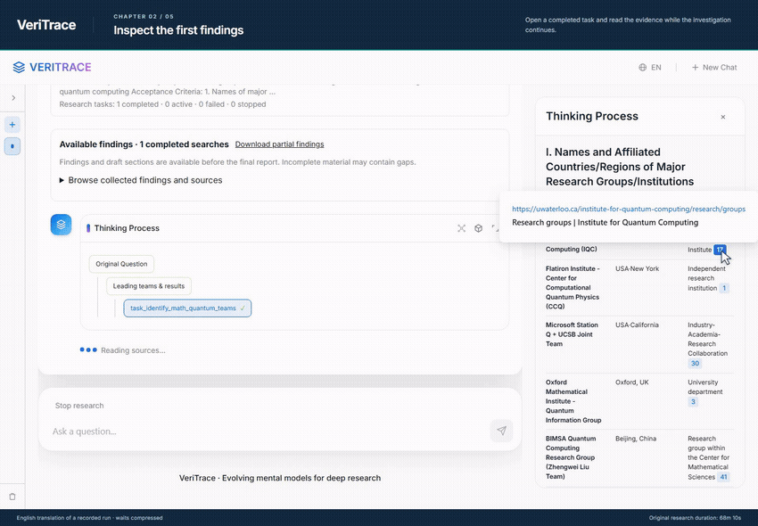
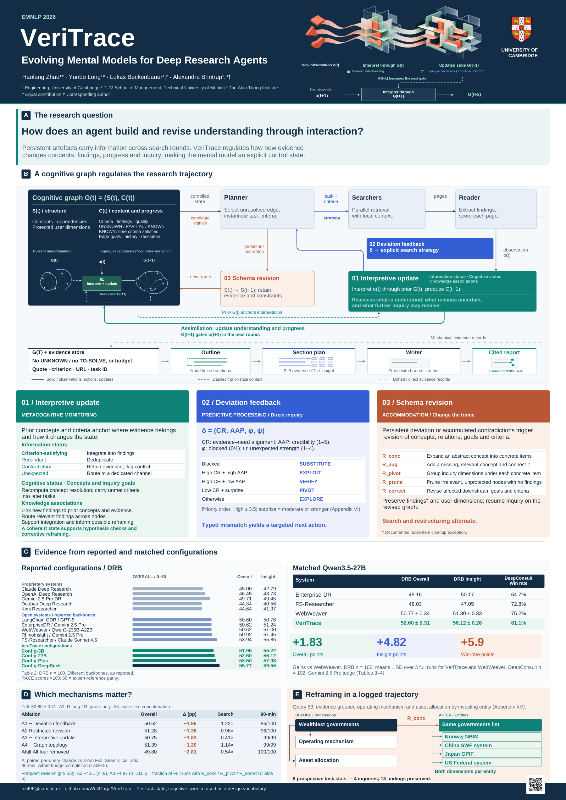
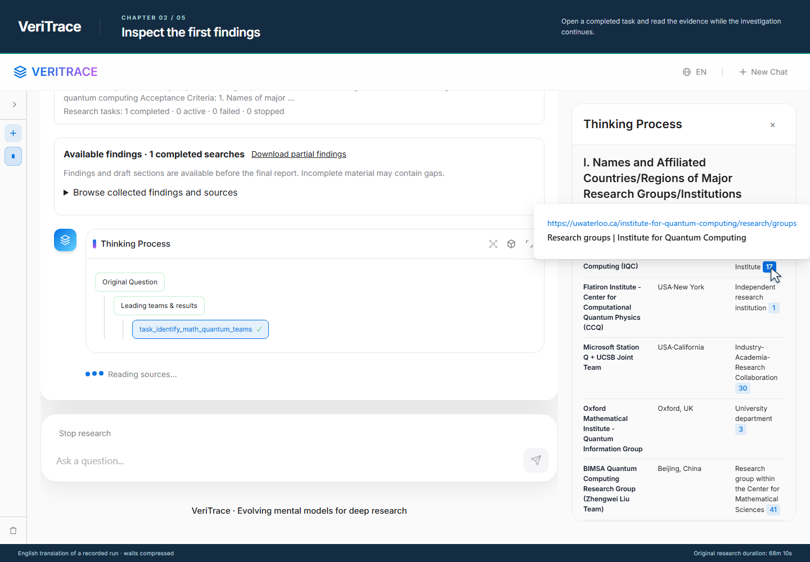
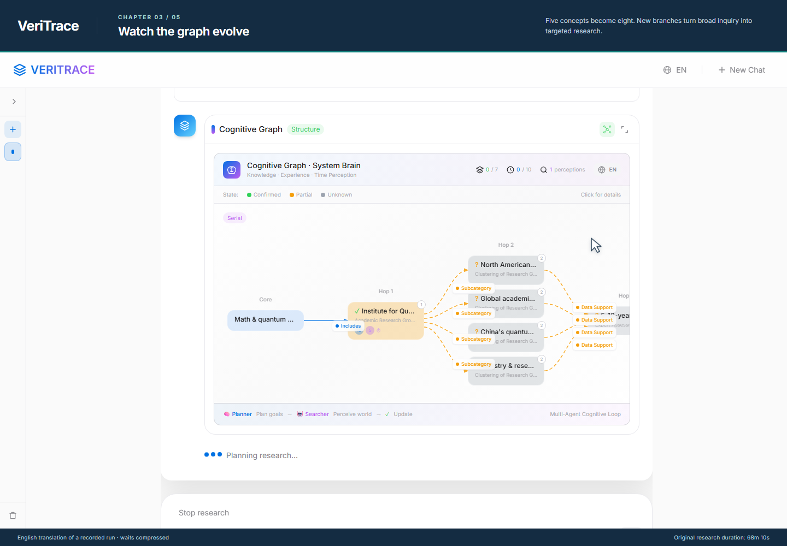
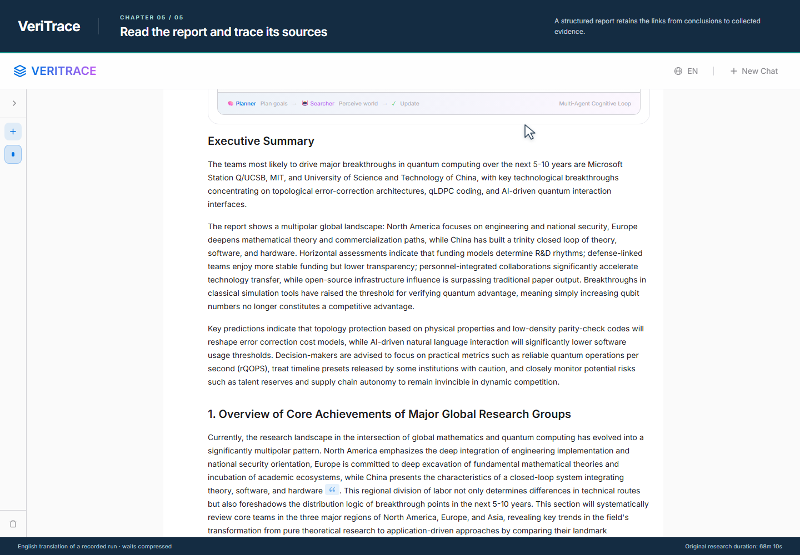

<p align="center"></p>

<p align="center">
  <a href="https://arxiv.org/abs/2605.26081"></a>
  <a href="https://arxiv.org/abs/2605.26081"></a>
  <a href="https://github.com/WolfGaga/VeriTrace/actions/workflows/ci.yml"></a>
  <a href="LICENSE"></a>
</p>

<p align="center"><strong>Deep research with an evolving understanding of the task.</strong><br>VeriTrace organizes questions, findings and unresolved dependencies in a cognitive graph, then turns source evidence into a cited report.</p>

<p align="center"><a href="https://wolfgaga.github.io/VeriTrace/">Project page</a> · <a href="https://wolfgaga.github.io/VeriTrace/demo/">Interactive demo</a> · <a href="https://wolfgaga.github.io/VeriTrace/#demo">Video</a> · <a href="https://arxiv.org/abs/2605.26081">Paper</a> · <a href="#quickstart">Quickstart</a></p>

## See it work

<p align="center"><a href="https://wolfgaga.github.io/VeriTrace/demo/"></a><br><strong>Pause the replay. Open task findings. Explore the cognitive graph.</strong><br>No signup or API key required.</p>

<a href="https://wolfgaga.github.io/VeriTrace/demo/"></a>

**[Try the interactive demo](https://wolfgaga.github.io/VeriTrace/demo/)** or **[watch the guided video](https://wolfgaga.github.io/VeriTrace/#demo-video)**. The demo replays selected events from a real research run on mathematics and quantum computing: **12 search tasks**, with a graph that grows from **5 to 8 concepts**. The original run took **68 minutes 10 seconds**; waiting periods are compressed. The guided video is about two minutes, with deliberate inspection of findings and graph states. Research text is presented in English translation. No API key is needed. [Demo details](docs/demo.md).

## What VeriTrace does

| Capability | What you can inspect |
|---|---|
| **Evolving cognitive graph** | Concepts, dependencies, discoveries and unresolved questions; graph revision as the investigation develops. |
| **Parallel exploration** | Search tasks, source selection, reading activity and source-quality feedback. |
| **Traceable synthesis** | Evidence and global citation IDs connecting findings, report sections and sources. |
| **Three-stage writing** | Outline planning, section-level evidence planning, then section writing and an executive summary. |
| **Usable long-running research** | Live stages, partial findings, drafts, stop/continue controls and checkpoint recovery. |
| **Flexible interfaces** | React, Python, HTTP, CLI and batch execution; English and Chinese prompts; report rewriting from saved evidence. |

The method implements **interpretive update**, **deviation feedback** and **schema revision**. See the [paper](https://arxiv.org/html/2605.26081v2#S3) for the method and the [code map](VERITRACE/docs/architecture.md) for the implementation.

## Research poster

<p align="center"><a href="docs/assets/veritrace-poster.pdf"></a></p>

<p align="center"><a href="docs/assets/veritrace-poster.pdf">Open the full-resolution poster (PDF)</a> · <a href="VERITRACE/docs/architecture.md">Implementation code map</a></p>

## Results reported in the paper

> **Strongest reproducible open-source result on DeepResearch Bench**
>
> **55.77 Overall · 59.56 Insight** with Config-DeepSeek, within the comparison reported in [paper Table 2](https://arxiv.org/html/2605.26081v2#S5.T2).

| Result | Score |
|---|---:|
| **Config-DeepSeek — DeepResearch Bench RACE Overall** | **55.77** |
| Config-DeepSeek — RACE Insight | **59.56** |
| **Config-27B — RACE Overall, three full runs** | **52.60 ± 0.31** |
| Config-27B — DeepConsult Overall win rate | **81.1%** |

### Controlled comparison: shared Qwen3.5-27B backbone

| Rank in this comparison | System | RACE Overall ↑ | Insight ↑ |
|---:|---|---:|---:|
| **1** | **VeriTrace** | **52.60 ± 0.31** | **56.12 ± 0.26** |
| 2 | WebWeaver | 50.77 ± 0.34 | 51.30 ± 0.33 |
| 3 | Enterprise-DR | 49.16 | 50.17 |
| 4 | FS-Researcher | 48.03 | 47.05 |

VeriTrace improves over the strongest matched baseline by **1.83 points Overall** and **4.82 points on Insight**. VeriTrace and WebWeaver report mean ± standard deviation over three independent full runs. These are paper-reported comparisons, **not a claim of a current official leaderboard position**. [Full results and provenance](docs/benchmarks.md) · [Paper, Tables 2–4](https://arxiv.org/html/2605.26081v2#S5).

## Interface

<table>
  <tr><td></td><td></td></tr>
  <tr><td><strong>Follow the investigation</strong><br>Read completed findings while other tasks continue.</td><td><strong>Inspect the evolving structure</strong><br>Explore concepts, dependencies and findings.</td></tr>
</table>



Screenshots use the production frontend with an English translation of the recorded research. The original Chinese-language run, its structure, references and numerical quantities are retained; the translation is for presentation, not a new research run.

## Cost per research query

The paper reports **$0.63–$1.96 in mean LLM token cost per query**, using its May 2026 uncached model rates and **7.2 CNY/USD** conversion.

| Configuration | Estimated LLM cost/query |
|---|---:|
| Config-3B | $0.74 |
| Config-27B | **$0.63** |
| Config-Plus | $1.39 |
| Config-DeepSeek | **$1.96** |

Config-DeepSeek uses Pro for planning, search and writing, and Flash for high-volume reading, filtering and graph updates. These figures exclude search services, hosting and evaluation fees. They are historical paper estimates, not current provider quotes. [Explore configurations and illustrative budgets](https://wolfgaga.github.io/VeriTrace/#cost) · [Cost methodology](docs/costs.md).

## Quickstart

Requirements: **Python 3.10+**, and **Node.js 20+** for the React frontend.

```bash
git clone https://github.com/WolfGaga/VeriTrace.git
cd VeriTrace/VERITRACE
python -m pip install -e ".[documents,dev]"
```

Copy `.env.example` to `.env` and add your model-provider and search credentials. The example selects Config-27B. Keep `VERITRACE/` and `deep_research_bench/` as siblings.

```bash
# Terminal 1: API
python -m veritrace.app --host 127.0.0.1 --port 8002 --lang en

# Terminal 2: frontend, from VERITRACE/
cd frontend/React
npm ci
npm start
```

Open **http://localhost:8080**. Use the language control to select English or Chinese prompts. See [configuration](VERITRACE/docs/configuration.md) for model roles, providers and search limits.

```bash
# From VERITRACE/: terminal, batch research, evidence replay and evaluation
python -m veritrace.terminal
python benchmark/run_terminal.py --input queries.jsonl --output eval_data/results.jsonl --save-evidence
python benchmark/run_rewrite.py --evidence evidence.json --output report.jsonl
python benchmark/run_eval.py --help
```

## Documentation and development

| Guide | Contents |
|---|---|
| [Configuration](VERITRACE/docs/configuration.md) | Model roles, credentials, defaults and tuning. |
| [Architecture](VERITRACE/docs/architecture.md) | Modules, research events, evidence and writing. |
| [Diagnostics](VERITRACE/docs/diagnostics.md) | Log levels and progress records. |
| [Troubleshooting](VERITRACE/docs/troubleshooting.md) | Errors, interrupted runs and recovery. |
| [Testing](VERITRACE/tests/README.md) | Offline, live opt-in and browser checks. |
| [Evaluation](VERITRACE/benchmark/DATA_README.md) | Batch runs, saved evidence, FACT and RACE. |
| [Cost analysis](docs/costs.md) | USD conversion, per-query usage and cost-control mechanisms. |
| [Contributing](CONTRIBUTING.md) | Reproducing issues and proposing changes. |
| [License and collaboration](docs/licensing.md) | Apache 2.0 permissions and project contact. |

```bash
# From VERITRACE/
python -m pytest
python -m ruff check veritrace tests

# From VERITRACE/frontend/React/
npm test
npm run build
```

Offline tests block external network calls by default. Live model tests require explicit opt-in. CI checks Python behavior and the production frontend build.

## Citation

**Haolang Zhao, Yunbo Long, Lukas Beckenbauer, Alexandra Brintrup.** *VeriTrace: Evolving Mental Models for Deep Research Agents.* Accepted to Findings of EMNLP 2026.

```bibtex
@article{zhao2026veritrace,
  title   = {VeriTrace: Evolving Mental Models for Deep Research Agents},
  author  = {Zhao, Haolang and Long, Yunbo and Beckenbauer, Lukas and Brintrup, Alexandra},
  journal = {arXiv preprint arXiv:2605.26081},
  year    = {2026},
  doi     = {10.48550/arXiv.2605.26081},
  url     = {https://arxiv.org/abs/2605.26081}
}
```

## Contact and collaboration

For research collaborations, evaluation studies, industry applications and technical partnerships, contact **[hz496@cam.ac.uk](mailto:hz496@cam.ac.uk?subject=VeriTrace%20collaboration)**. For reproducible bugs and feature requests, use [GitHub Issues](https://github.com/WolfGaga/VeriTrace/issues).

## License and acknowledgements

VeriTrace is released under [Apache 2.0](LICENSE), which permits commercial use subject to its terms. Contacting us is optional for uses permitted by the license; we welcome collaboration. See [license and collaboration](docs/licensing.md).

We acknowledge [DeepResearch Bench](https://github.com/Ayanami0730/deep_research_bench) and [DeepConsult](https://github.com/youdotcom-oss/ydc-deep-research-evals) for their benchmarks and evaluation tools. Third-party components retain their respective licenses and attribution. See [media credits](docs/media-credits.md) for the poster, soundtrack and fonts.
