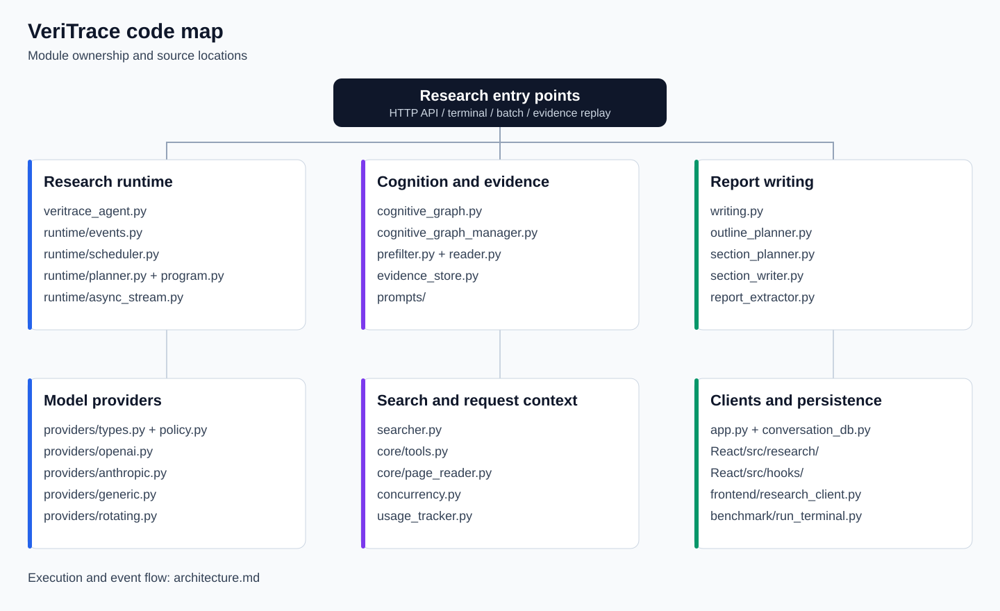
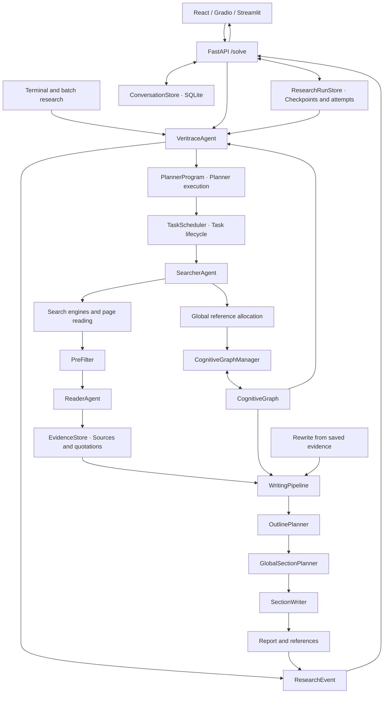
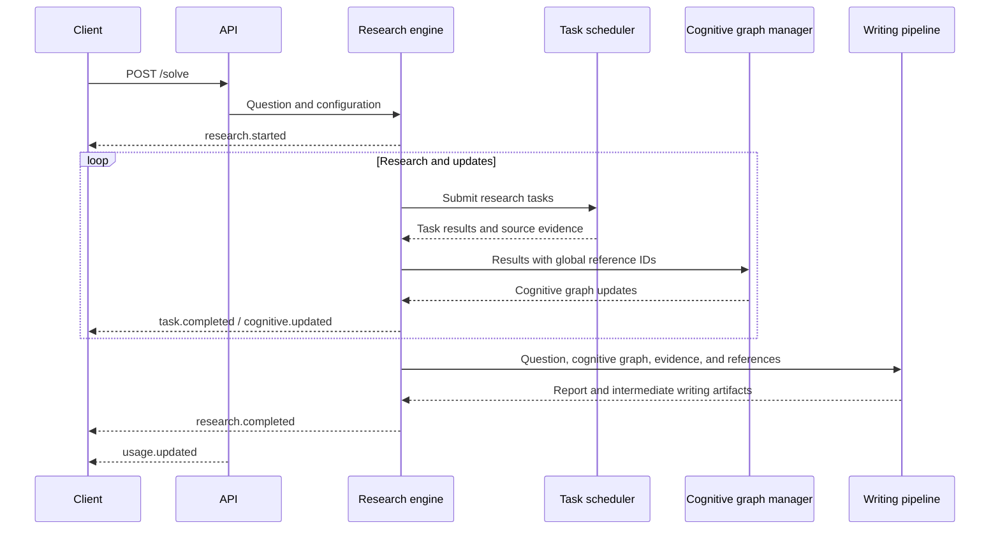

# VeriTrace code map

VeriTrace manages task execution, the cognitive graph, evidence, and the final report separately. All entry points share the research engine and writing pipeline. Clients update their views through explicit research events.

## Module locations

| Responsibility | File or directory |
|---|---|
| Research entry point and coordination of search, cognitive updates, and writing | `veritrace/agent/veritrace_agent.py` |
| Events, task results, and report results | `veritrace/agent/runtime/events.py` |
| Task submission, completion, errors, and cancellation | `veritrace/agent/runtime/scheduler.py` |
| Planner command interface and execution | `veritrace/agent/runtime/planner_graph.py`, `planner.py`, `program.py` |
| Bridge from synchronous execution to asynchronous events | `veritrace/agent/runtime/async_stream.py` |
| Request-local stage events and task context | `veritrace/agent/runtime/progress.py` |
| Search strategy and tool result handling | `veritrace/agent/searcher.py` |
| Search configuration, source cache, and search engines | `veritrace/agent/core/tools.py` |
| HTML, PDF, spreadsheet, OCR, and browser reading | `veritrace/agent/core/page_reader.py` |
| Filtering, reading, and evidence storage | `prefilter.py`, `reader.py`, `evidence_store.py` |
| Cognitive graph structure and updates | `cognitive_graph.py`, `cognitive_graph_manager.py` |
| Model instructions | `veritrace/agent/prompts/` |
| Three-stage writing | `writing.py`, `outline_planner.py`, `section_planner.py`, `section_writer.py` |
| Model providers, request policies, and response types | `veritrace/agent/providers/` |
| Request context and usage tracking | `concurrency.py`, `usage_tracker.py` |
| HTTP, conversation history, and evaluation exports | `veritrace/app.py`, `conversation_db.py` |
| Durable research checkpoints, recovery metadata, and attempt leases | `veritrace/research_runs.py` |
| Console/file logging and request progress diagnostics | `veritrace/logging_config.py`, `veritrace/app.py` |
| React event state and historical session readers | `frontend/React/src/research/` |
| Batch execution and rewriting from saved evidence | `benchmark/run_terminal.py`, `run_parallel.py`, `run_rewrite.py` |

`section_planner.py` plans sections sequentially so that later sections can use earlier plans. Search tasks and page reading run concurrently.

## Data and events

Events use `schema_version: 2` and contain `type`, `data`, and an optional `task_id`. Task states are `pending`, `running`, `completed`, `failed`, or `cancelled`. The `research.completed` payload contains `article`, `ref2url`, `tasks`, and `cognitive_graph`.

`research.progress` carries the current `stage` and optional task, source, or section details. Worker pools retain its request-local observer and task context. The transport publishes these updates while the research iterator is blocked inside a model call; the observer does not change model requests or research results. `research.heartbeat` reports elapsed waiting time after 15 seconds without a research update. Clients retain the current stage across heartbeats and ignore late progress after a terminal event.

Planner task queries expose task metadata, response text, references, search messages, and evidence. Normal mode uses plain node dictionaries, including question and completion markers. Native task snapshots exclude these markers, so they do not appear as research tasks. Isolated mode exposes copied task-query results.

Local search references receive global IDs before cognitive updates. The same URL reuses its ID, linking evidence quotations, graph findings, and report citations. The writing pipeline plans sections, binds insights to evidence, and then writes each section. If insight planning fails, the writer uses all available evidence assigned to that section.

## Planner execution

`PlannerProgram` retains variables between Planner turns and provides a restricted set of Python builtins. Normal execution is the default (`PLANNER_ISOLATION=false`): Planner snippets can use the task graph compatibility API and task state alongside the research commands. Ordinary import statements remain unavailable in this builtin environment.

`PLANNER_ISOLATION=true` adds syntax, private-attribute, frame-access and string-formatting checks and copies task-query results. This optional mode can reject valid normal-mode snippets and requires separate research-effect evaluation. It runs in the same backend process and does not provide an operating-system sandbox for untrusted remote code. See [configuration](configuration.md#planner-execution) for the setting and compatibility details.

## Lifecycle

- A research instance handles one request at a time. Request context isolates usage accounting across instances.
- The scheduler owns its thread pool and task state; clients do not manipulate internal queues or counters.
- Cancellation prevents further model and search requests. HTTP requests already in flight end at their provider timeout, and late results are discarded.
- Synchronous and asynchronous entry points share execution and cleanup. Event buffers are bounded, and the producer thread closes the iterator after the consumer exits.
- Once section writing starts, the pipeline shares a snapshot of the outline, requirements, and completed sections. Batch timeout or error handling saves that snapshot atomically while retaining the failure status. Saved evidence can be replayed through the same three-stage writer without repeating retrieval.
- Conversation storage supports saving, reading, soft deletion, recovery, and explicit permanent deletion. Historical data conversion is confined to client read boundaries.

## Interrupted research

The React client exposes completed search answers and sources while research is running. Users can download partial findings, stop research, continue from a saved checkpoint, or write a report from collected evidence. Draft sections appear as they finish and remain labelled incomplete until the final report arrives. Only completed reports expose evaluation export.

`POST /solve` accepts an optional `resume_run_id` and `recovery_action` (`continue` or `write_report`). Recovery uses trusted server checkpoints and the original question and language. `GET /api/research/{run_id}` returns saved user-facing results and recovery availability; `POST /api/research/{run_id}/stop` requests cancellation. Checkpoints retain completed tasks, cognitive state, reference allocation, planner variables, section plans, and completed report sections. Explicit continuation starts a new planning budget and retries unfinished searches; completed searches are retained. Report recovery reuses the completed prefix of sections and generates the remaining sections and executive summary.

The solve response also exposes the run ID and attempt in HTTP headers, allowing recovery when stream frames are lost. A completed server report is restored without starting another model request. Stop signals interrupt the event consumer while an in-flight provider call finishes independently; late results are discarded. Caught searcher API failures, including final answer synthesis, remain failed tasks and retain their collected evidence for inspection.

The API stores checkpoints in the conversation SQLite database. Each attempt has a lease, so late writes from a previous attempt cannot overwrite a newer attempt. Usage snapshots are saved when requests end, including disconnects, and accumulated across recovery attempts without double counting. Planner context stays on the server. Saving errors are logged and exposed to the client; users can still download material held in the page. A backend restart preserves saved work. In-flight provider requests may take time to finish after cancellation; their late results do not replace a newer attempt. Run this API as a single worker; active-request ownership is local to that worker. Gradio and Streamlit share engine events but do not expose the React recovery controls.

## Validation

`python -m pytest` runs offline tests and blocks external network access by default. Coverage includes citation provenance, Reader parsing, graph updates and restructuring, writing fallbacks, model retries, API and persistence contracts, and complete research flows driven by simulated models. Live model tests require explicit opt-in.

React uses TypeScript checks, production builds, and local browser workflows. See the [testing guide](../tests/README.md) and [browser client guide](../frontend/React/README.md) for commands and coverage.
